# Riemann Hypothesis proof diagrams

Diagrams of the theorem dependency graph of Levent Alpöge's Lean proof of the
Riemann Hypothesis: two generated teaching posters, and Graphviz diagrams of
the dependency tree and of single chains of reductions.

Nothing here builds the Lean source. The graph is read from the
[riemann-blueprint](https://github.com/chrisflav/riemann-blueprint): 416 statements, each one a
Markdown file with TOML front matter naming its Lean declarations and the
statements it `uses`, plus `lean-facts.json`, which gives a signature, file
and line for every Lean name. The blueprint was itself reconstructed by a
static analysis of the formal proof (see its README for the limits of that).
Its edges are then checked against the references of the published formal
proof, read from Sutherland's export of it
([diagrams/EDGES.md](diagrams/EDGES.md)).

## Posters

Two generated SVG posters draw the proof for teaching. Open them on their own
and zoom in.

- [`Main.lean`, theorem by theorem](diagrams/R1-main-theorems-2026.11.23.svg):
  the five theorems, the definitions they are stated with, the chain of
  reductions that proves them, and the theorems the chapters deliver, each with
  its Lean signature, statement, proof and uses.
- [The proof, chapter by chapter](diagrams/R2-chapters-2026.11.23.svg): the
  nine chapters of the blueprint, what each proves, which chapters use which,
  and the published results the proof cites most.
- [The zero-free chapter, lemma by lemma](diagrams/R3-zero-free-2026.11.23.svg):
  the analytic half of the proof from the inside, all 24 statements of the
  chapter as cards, with the argument's strands as columns and the chapter's
  theorem at the foot.
- The other five stage chapters, one poster each, laid out from the chapter's
  own dependency graph:
  [families](diagrams/R4-families-2026.11.23.svg),
  [theta lifts](diagrams/R5-theta-2026.11.23.svg),
  [heights](diagrams/R6-heights-2026.11.23.svg),
  [the Tate–Shafarevich bound](diagrams/R7-sha-2026.11.23.svg) and
  [Galois representations](diagrams/R8-galois-2026.11.23.svg).
- Two traces, one chain of reductions each as cards in reading order:
  [the deepest chain](diagrams/T1-trace-deepest-2026.11.23.svg), eleven
  statements from a local lattice count up to the Riemann Hypothesis, and
  [the chain to Landau's theorem](diagrams/T2-trace-landau-2026.11.23.svg),
  the analytic end of the proof in six steps.
- [What the stages pass to each other](diagrams/F1-definitions-2026.11.23.svg):
  the proof in a second frame, its 24 definitions rather than its theorems,
  each above the definitions stated in terms of it, with a table of which
  chapter makes each one and which chapters consume it.
- [What is new](diagrams/F2-new-2026.11.23.svg): the proof organised by
  provenance, its 200 new statements by chapter and section, how the new
  work of one chapter leans on another's, what it takes from the literature
  and where it reaches back into it.
- [The proof as code](diagrams/F3-modules-2026.11.23.svg): the blueprint's
  chapters against the formalisation's modules, the only frame that puts the
  paper and the Lean side by side, with each chapter's footprint in the code
  and the fan-out from a statement to the declarations it stands for.
- [The proof as literature](diagrams/F4-literature-2026.11.23.svg): the 209
  references on a timeline by decade, which statements cite each, the
  references the proof leans on most, and the upward cone of each, what
  would fall if the result were wrong; every title links to the paper.
- [The sections, the middle level](diagrams/F5-sections-2026.11.23.svg): the
  58 sections as cards, chapter by chapter, each above the sections whose
  proofs use it, with the proof uses between them as labelled arrows.
- [Depth as geometry](diagrams/F6-depth-2026.11.23.svg): every statement on
  one wheel, rings by distance from the main theorems and sectors by chapter,
  with the two trace chains drawn through the rings.
- [The blueprint against the Lean](diagrams/F7-verdicts-2026.11.23.svg):
  every arrow of the blueprint checked against the formal proof's
  references, chapter against chapter, with the statements the disagreements
  concentrate in, the uses the Lean makes that no arrow draws, and each
  statement's depth in the two graphs.
- [Where the assumptions enter](diagrams/F8-assumptions-2026.11.23.svg): the
  structures of assumptions the proof's theorems take, with what their fields
  state, who takes them and who builds them, and every claim the blueprint
  states as a `Prop`, by whether the proof concludes it.
- [Where the formal work is](diagrams/F9-weight-2026.11.23.svg): the Lean
  declarations under each statement, by chapter and provenance, the
  statements with the most formal work of their own against the length of
  their proofs in the blueprint, and two statements opened to their helpers.
- [Between the pins](diagrams/F10-drift-2026.11.23.svg): what changed in the
  formal proof from the commit the blueprint pins to the mirror's head, by
  kind of name, for each of the blueprint's Lean names, by namespace, and
  for the statements whose Lean lost the most.

[](diagrams/R1-main-theorems-2026.11.23.svg)

They are generated from the blueprint and the mirror, and the build fails if
the two disagree with what is drawn: see [diagrams/README.md](diagrams/README.md).
What on a poster is quoted, what is computed and what is written here is set
out in [diagrams/TEXT.md](diagrams/TEXT.md); why the light theme's page is a
93% grey, and how that was measured, in [diagrams/PAGE.md](diagrams/PAGE.md);
how the blueprint's arrows compare with the formal proof's references, in
[diagrams/EDGES.md](diagrams/EDGES.md).
A release is a version tag; each one carries every poster as a file, both
sets, with checksums and the pins they were drawn from, so a poster can be
cited by release and fetched after the tree has moved on: see
[the releases](https://github.com/scottcochran/riemann-diagrams/releases)
and `PLAN.md`, Phase 5.
Each poster also exists in a map form under [diagrams/map/](diagrams/map/) that
quotes nothing of the blueprint's text or the proof's source. The blueprint's
prose is CC BY 4.0 by its author's grant of 2026.11.22; the proof's source is
not licensed; [NOTICE](NOTICE) records both.
On a poster opened on its own, as the Pages site serves it, an id that names
a card on the same poster, or on another poster of the set, is a link to it,
and the Lean line and the blueprint path at the foot of a card link to the
sources at their pinned commits; inside this README's embed the poster draws
the same and links nowhere.

## Graphviz diagrams

The dependency graph drawn as a state space: the theorems of `Main.lean` are
the start, a `uses` edge is a step, and a statement's depth is the number of
steps from the main theorems. The single-chain traces this family had are
retired in favour of the T posters above; `trace_proof.py` still prints and
draws a chain on request.

| File | What it shows |
|---|---|
| `graphs/riemann_chapters.png` | the nine chapters of the blueprint and which chapters use which, with statement counts by provenance |
| `graphs/riemann_depth3.png` | every statement within 3 reductions of the main theorems (27 statements); the cut-off boxes say how many statements lie below |
| `graphs/riemann_depth4.png` / `.svg` | the same to depth 4 (147 statements): the wide poster |
| `graphs/riemann_full.dot` / `.svg` | all 416 statements and 2004 edges; each node links to its page on the blueprint site |

Every box is one statement: its title, blueprint id, kind and provenance,
its first Lean declaration with the file and line in the
[mirror](https://github.com/leanprover-community/riemann-hypothesis), and its chapter.
The theorems of `Main.lean` are yellow; the other fills are the blueprint
site's own colours for published, modified and new results. Solid edges are
proof uses (the reductions), dashed edges are statement uses (the definitions
and hypotheses a statement is written in). Definitions have dashed borders,
remarks dotted.

## Running the Graphviz scripts

Needs Python 3.12+ (for `tomllib`), [uv](https://docs.astral.sh/uv/) and the
`dot` binary from Graphviz (`brew install graphviz`). The blueprint is expected
at `../riemann-blueprint/blueprint`; set `RIEMANN_BLUEPRINT` or pass
`--blueprint DIR` to read it from elsewhere.

```sh
uv run graphs/visualize_theorems.py            # riemann_depth3.png and a depth table
uv run graphs/visualize_theorems.py 4          # riemann_depth4.png and .svg
uv run graphs/visualize_theorems.py --chapters # riemann_chapters.png
uv run graphs/visualize_theorems.py --full     # riemann_full.dot and .svg

uv run graphs/trace_proof.py                            # the deepest chain
uv run graphs/trace_proof.py --first thm-half-plane     # follow the first proof use from a statement
uv run graphs/trace_proof.py --to thm-landau-windows    # the chain from the main theorems to a statement
```

The outputs land in `graphs/`, whatever the working directory. `visualize_theorems.py` also prints the statements by depth:

```
Depth | Statements | Published | Modified | New
------+------------+-----------+----------+-----
   0  |       3    |      0    |     0    |    3
   1  |       4    |      2    |     0    |    2
   2  |       3    |      1    |     1    |    1
   3  |      17    |      2    |     3    |   12
   4  |     120    |     65    |    14    |   38
   5  |     131    |     49    |    34    |   43
   6  |      76    |     20    |     6    |   50
   7  |      38    |      2    |     1    |   35
   8  |      13    |      0    |     1    |   12
   9  |       3    |      0    |     1    |    2
  10  |       1    |      0    |     0    |    1
```

## Files

| File | What it is |
|---|---|
| `graphs/blueprint_graph.py` | reads the blueprint into a graph: nodes, `uses` edges, depths, traces, box labels and colours; the posters read the blueprint through it too |
| `graphs/visualize_theorems.py` | the depth-limited tree, the chapter overview and the full graph |
| `graphs/trace_proof.py` | prints a single chain of reductions, and draws it with Graphviz on request |
| `pyproject.toml` | the one dependency, the `graphviz` Python package (the posters need none) |
| `diagrams/` | the posters and their generator |
| `skills/`, `.claude-plugin/` | the `proof-posters` Claude Code plugin: the skills that keep the posters true to their sources |
| `proof-posters.toml` | where those skills find this repository's pins, checks, papers and release settings |
| `CLAUDE.md`, `.claude/` | the rules every change keeps, and the poster recipe, for Claude Code sessions in this repository |

## Skills

The work that no script does is written up as Claude Code skills. Moving the pins, linking the papers, rebuilding
the Lean-derived files and cutting a release are general: they are a plugin, `proof-posters`, in
[skills/](skills/README.md). The plugin reads this repository's layout from `proof-posters.toml`, so another
project can use it with a file of its own. Drawing a poster is specific to this repository and is in
`.claude/skills/`. To install the plugin elsewhere:

```
/plugin install proof-posters --marketplace scottcochran/riemann-diagrams
```

## What the graph is not

The edges come from the blueprint's `uses` lists, which were resolved from
identifiers in the Lean source text without building it, so some edges are
wrong and the blueprint records no proof status. The chapter and trace posters
draw each edge by its verdict against the formal proof's references, and F7
lays the verdicts out chapter by chapter; a verdict says whether one
statement's Lean reaches another's, not whether either is proved. A box here says which Lean
declarations a statement stands for. Whether they are proved is a question for
the kernel checks, which R1's band 5 reports from the mirror's
`verification/NOTES.md` and the pages of `diagrams/src/checks.toml`: the
archive as published compiled in full, so Lean's kernel checked each of its
declarations, and the proof of the five theorems of `Main.lean` has been accepted by independent
kernels and certified by the Lean and Mathlib communities. No check covers the
edges, or whether the blueprint's words say what a declaration says.

## Attribution

* **The proof, the formal proof and the announcement** are the work of
  **Levent Alpöge**, published at <https://alpo.ge/remark.pdf> and as the Lean
  archive linked there. The mathematics these diagrams describe is his. The
  formal proof was published without a license; this repository contains none
  of its source. The reader posters quote a declaration's signature, with the
  file and line it is at; the map posters carry only its name and location.
* **The blueprint** [chrisflav/riemann-blueprint](https://github.com/chrisflav/riemann-blueprint)
  and its authors wrote the statements, proofs, introductions and `source`
  lines the diagrams draw, and resolved the `uses` edges they follow. The
  posters read them at build time, at the pinned commit, and quote them
  abridged and attributed. The blueprint carries no licence file at that
  commit, and a request for one is open with its authors ([NOTICE](NOTICE)).
* **The community mirror**
  [leanprover-community/riemann-hypothesis](https://github.com/leanprover-community/riemann-hypothesis)
  and its maintainers provided `Main.lean`, `Statements.lean` and
  `comparator.json`, which R1 states the theorems from, and the verification
  notes (`verification/NOTES.md`), which R1's band on what has been checked
  paraphrases.
* **The checks of the formal proof** that R1's band 5 reports are those
  described in three pages, recorded with the day each was read and a hash of
  the passage read in [`diagrams/src/checks.toml`](diagrams/src/checks.toml): Andrew Sutherland's
  [verification files](https://math.mit.edu/~drew/grh/) (MIT, checks run with
  Claude Code), the Lean and Mathlib communities'
  [joint statement](https://leanprover-community.github.io/blog/posts/riemann-hypothesis/),
  and the Xena Project's post
  [“…and the proof is checked in Lean”](https://xenaproject.wordpress.com/2026/11/12/and-the-proof-is-checked-in-lean/),
  whose four questions band 5 is arranged by. R1 paraphrases them and quotes
  one sentence of the joint statement.
* **The blueprint tool** [chrisflav/blueprint](https://github.com/chrisflav/blueprint)
  defines the format the blueprint is written in and builds its website, which
  the full Graphviz graph links each statement to.
* **[Mathlib](https://github.com/leanprover-community/mathlib4)** and
  **[Lean](https://lean-lang.org)** underlie the formal proof.
* **[Graphviz](https://graphviz.org)** lays out the diagrams under `graphs/`.
* **The Noto fonts** every poster embeds are Copyright 2022 The Noto Project
  Authors, under the SIL Open Font License 1.1 (`diagrams/src/fonts/OFL.txt`).
  The drawing library `diagrams/src/lib.py` is TOPAK's, Apache-2.0, by the
  same author as this repository.
* **The classical results** the proof cites are attributed to their authors in
  the blueprint's text of each statement, and by the `source` lines F4 draws.

## License

Code and tooling are Apache-2.0 ([LICENSE](LICENSE)); documentation, including
the rendered diagrams, is CC BY 4.0 ([LICENSE-DOCS](LICENSE-DOCS)). See
[NOTICE](NOTICE) for how the split applies, and for what the diagrams quote
from the blueprint and from the formal proof, which stays its authors' and is
covered by neither licence.
