# Riemann Hypothesis proof diagrams

Diagrams of the theorem dependency graph of Levent Alpöge's Lean proof of the
Riemann Hypothesis: two generated teaching posters, and Graphviz diagrams of
the dependency tree and of single chains of reductions.

Nothing here reads or builds the Lean source. The graph is read from the
[riemann-blueprint](../riemann-blueprint/): 416 statements, each one a
Markdown file with TOML front matter naming its Lean declarations and the
statements it `uses`, plus `lean-facts.json`, which gives a signature, file
and line for every Lean name. The blueprint was itself reconstructed by a
static analysis of the formal proof (see its README for the limits of that).

## Posters

Two generated SVG posters draw the proof for teaching. Open them on their own
and zoom in.

- [`Main.lean`, theorem by theorem](diagrams/R1-main-theorems-2026.11.22.svg):
  the five theorems, the definitions they are stated with, the chain of
  reductions that proves them, and the theorems the chapters deliver, each with
  its Lean signature, statement, proof and uses.
- [The proof, chapter by chapter](diagrams/R2-chapters-2026.11.22.svg): the
  nine chapters of the blueprint, what each proves, which chapters use which,
  and the published results the proof cites most.

[](diagrams/R1-main-theorems-2026.11.22.svg)

They are generated from the blueprint and the mirror, and the build fails if
the two disagree with what is drawn: see [diagrams/README.md](diagrams/README.md).

## Graphviz diagrams

The dependency graph drawn as a state space: the theorems of `Main.lean` are
the start, a `uses` edge is a step, and a statement's depth is the number of
steps from the main theorems.

| File | What it shows |
|---|---|
| `riemann_chapters.png` | the nine chapters of the blueprint and which chapters use which, with statement counts by provenance |
| `riemann_depth3.png` | every statement within 3 reductions of the main theorems (27 statements); the cut-off boxes say how many statements lie below |
| `riemann_depth4.png` / `.svg` | the same to depth 4 (147 statements): the wide poster |
| `riemann_trace.png` | the deepest chain of reductions: 10 steps from `riemannHypothesis` down to a lemma on local lattice counts |
| `riemann_trace_first_thm-half-plane.png` | the chain found by following the first proof use at each step, from the half-plane theorem |
| `riemann_trace_to_thm-landau-windows.png` | the 5-step chain from `riemannHypothesis` to Landau's theorem, the analytic end of the proof |
| `riemann_full.dot` / `.svg` | all 416 statements and 2004 edges; each node links to its page on the blueprint site |

Every box is one statement: its title, blueprint id, kind and provenance,
its first Lean declaration with the file and line in the
[mirror](../leanprover-community/riemann-hypothesis/), and its chapter.
The theorems of `Main.lean` are yellow; the other fills are the blueprint
site's own colours for published, modified and new results. Solid edges are
proof uses (the reductions), dashed edges are statement uses (the definitions
and hypotheses a statement is written in). Definitions have dashed borders,
remarks dotted. A trace ends in a red box naming the statement's source in
the literature.

## Running the Graphviz scripts

Needs Python 3.12+ (for `tomllib`), [uv](https://docs.astral.sh/uv/) and the
`dot` binary from Graphviz (`brew install graphviz`). The blueprint is expected
at `../riemann-blueprint/blueprint`; set `RIEMANN_BLUEPRINT` or pass
`--blueprint DIR` to read it from elsewhere.

```sh
uv run visualize_theorems.py            # riemann_depth3.png and a depth table
uv run visualize_theorems.py 4          # riemann_depth4.png and .svg
uv run visualize_theorems.py --chapters # riemann_chapters.png
uv run visualize_theorems.py --full     # riemann_full.dot and .svg

uv run trace_proof.py                            # the deepest chain
uv run trace_proof.py --first thm-half-plane     # follow the first proof use from a statement
uv run trace_proof.py --to thm-landau-windows    # the chain from the main theorems to a statement
```

`visualize_theorems.py` also prints the statements by depth:

```
Depth | Statements | Published | Modified | New
------+------------+-----------+----------+-----
   0  |       3    |      0    |     0    |    3
   1  |       4    |      2    |     0    |    2
   2  |       3    |      1    |     1    |    1
   3  |      17    |      2    |     3    |   12
   4  |     120    |     65    |    14    |   38
   5  |     131    |     49    |    34    |   43
   6  |      76    |     20    |     6    |   50
   7  |      38    |      2    |     1    |   35
   8  |      13    |      0    |     1    |   12
   9  |       3    |      0    |     1    |    2
  10  |       1    |      0    |     0    |    1
```

## Files

| File | What it is |
|---|---|
| `blueprint_graph.py` | reads the blueprint into a graph: nodes, `uses` edges, depths, traces, box labels and colours |
| `visualize_theorems.py` | the depth-limited tree, the chapter overview and the full graph |
| `trace_proof.py` | a single chain of reductions |
| `pyproject.toml` | the one dependency, the `graphviz` Python package (the posters need none) |
| `diagrams/` | the posters and their generator |

## What the graph is not

The edges come from the blueprint's `uses` lists, which were resolved from
identifiers in the Lean source text without building it, so some edges are
wrong and the statuses of the formal proofs are unknown. A box here says
which Lean declarations a statement stands for, not that they are proved.
That belongs to the kernel checks described in the mirror's
`verification/NOTES.md`.

The proof, the formal proof and the announcement are the work of Levent
Alpöge. The blueprint is by the riemann-blueprint authors, built with the
[blueprint](https://github.com/chrisflav/blueprint) tool.
