# Diagrams of the theorem dependency graph of Levent Alpöge's Lean proof of the Riemann Hypothesis

Sixteen generated SVG posters of the proof, drawn for teaching. They have clickable links, adapt to
light and dark, and are meant to be opened on their own and zoomed.

Nothing here reads or builds the Lean source. The graph is read from the
[riemann-blueprint](https://github.com/chrisflav/riemann-blueprint): 416 statements, each one a
Markdown file with TOML front matter naming its Lean declarations and the
statements it `uses`, plus `lean-facts.json`, which gives a signature, file
and line for every Lean name. The blueprint was itself reconstructed by a
static analysis of the formal proof (see its README for the limits of that).

## The posters

**Start here.**
- [R2](R2-chapters-2026.11.23.svg) for orientation
- [T2](T2-trace-landau-2026.11.23.svg) for the analytic reduction
- [R3](R3-zero-free-2026.11.23.svg) for that chapter in detail
- [F6](F6-depth-2026.11.23.svg) for every statement on one page
- [F2](F2-new-2026.11.23.svg) for what is new
- [F4](F4-literature-2026.11.23.svg) for a reference and what rests on it

Three families; the table below names each poster.

- Read the proof at one level each: [R1](R1-main-theorems-2026.11.23.svg),
  [R2](R2-chapters-2026.11.23.svg), [R3](R3-zero-free-2026.11.23.svg),
  [R4](R4-families-2026.11.23.svg), [R5](R5-theta-2026.11.23.svg),
  [R6](R6-heights-2026.11.23.svg), [R7](R7-sha-2026.11.23.svg),
  [R8](R8-galois-2026.11.23.svg)
- Follow one chain as a proof: [T1](T1-trace-deepest-2026.11.23.svg) the
  deepest, [T2](T2-trace-landau-2026.11.23.svg) to Landau's theorem
- View from different frames of reference: [F1](F1-definitions-2026.11.23.svg),
  [F2](F2-new-2026.11.23.svg), [F3](F3-modules-2026.11.23.svg),
  [F4](F4-literature-2026.11.23.svg), [F5](F5-sections-2026.11.23.svg),
  [F6](F6-depth-2026.11.23.svg), [F7](F7-verdicts-2026.11.23.svg),
  [F8](F8-assumptions-2026.11.23.svg), [F9](F9-weight-2026.11.23.svg)

[](R2-chapters-2026.11.23.svg)

| Id | Poster | What it shows |
|---|---|---|
| R1 | [`Main.lean`, theorem by theorem](R1-main-theorems-2026.11.23.svg) | The five theorems of `Main.lean`, the definitions they are stated with, the chain of reductions from `GRH, half-plane form` down to the theorems the chapters prove, and those theorems. Also `Main.lean` and `Statements.lean` as the mirror states them, the five stages of the proof, a table of statements by depth, and what has been checked of the formal proof. |
| R2 | [The proof, chapter by chapter](R2-chapters-2026.11.23.svg) | The nine chapters of the blueprint as cards: the Lean signature of the theorem each one proves, its introduction, its sections with statement counts, and which chapters it uses. Arrows are the chapter `uses` edges. Also the blueprint's own list of points to check first, and the twelve published results the proof cites most. |
| R3 | [The zero-free chapter, lemma by lemma](R3-zero-free-2026.11.23.svg) | All 24 statements of the chapter "From prime sums to the zero-free half-plane", the analytic half of the proof. Two dashed arrows are the hypotheses the chapter theorem takes rather than proves. Also what the chapter uses from outside, and the five section introductions in the chapter's own words. |
| R4 | [Families of definite unitary groups](R4-families-2026.11.23.svg) | The 44 statements that build the families the zero-free argument runs over. |
| R5 | [Theta lifts, periods and the Siegel–Weil formula](R5-theta-2026.11.23.svg) | The 61 statements about the theta lifts that join a family's members, the chapter's largest. |
| R6 | [Heights and the covolume bound](R6-heights-2026.11.23.svg) | The 32 statements of the Arakelov argument that bounds the lattices' covolumes. |
| R7 | [The Tate–Shafarevich bound](R7-sha-2026.11.23.svg) | The 35 statements from Kato's Euler system to the bound, with three results the main proof names as hypotheses. |
| R8 | [Galois representations](R8-galois-2026.11.23.svg) | The 38 statements that attach Galois representations to polarized pairs. |
| T1 | [The deepest chain](T1-trace-deepest-2026.11.23.svg) | Eleven statements from a local lattice count, the statement farthest from the main theorems, up to the Riemann Hypothesis, as full cards in reading order: a proof, left to right. |
| T2 | [The chain to Landau's theorem](T2-trace-landau-2026.11.23.svg) | The analytic end of the proof in six steps, from Landau's theorem of 1905 up to the Riemann Hypothesis. |
| F1 | [What the stages pass to each other](F1-definitions-2026.11.23.svg) | The 24 definitions of the blueprint rather than its theorems. Each is a card with its Lean declaration, the definition in words and the chapter that makes it, standing above the definitions stated in terms of it; the 18 arrows are those `uses` edges. A table counts, for each definition, the statements of each chapter that use it, so the flow of objects between the stages can be read off. The three definitions the outline names as the interfaces between stages are set out in its own words. |
| F2 | [What is new](F2-new-2026.11.23.svg) | The 200 statements the blueprint marks new in Alpöge's proof, one level up: each chapter a card holding only its new work, arrows between chapters labelled with the number of proof uses between their new statements, a matrix of those counts, every section by provenance, the twenty published and modified results the new statements lean on most, and the new lemmas that published results' proofs use. |
| F3 | [The proof as code](F3-modules-2026.11.23.svg) | The blueprint's nine chapters against the formalisation's modules, read from `lean-facts.json`, the index of the 1194 Lean declarations the statements name: a matrix of chapters against the 35 second-level modules, the formalisation's tree as one card per namespace, each chapter's footprint in the code, and the fan-out from one statement to its declarations, with the twelve statements that name the most. |
| F4 | [The proof as literature](F4-literature-2026.11.23.svg) | The 209 references of the blueprint on a timeline by decade, each with the number of statements whose `source` line cites it; the 25 references the proof leans on most, each with its upward cone, every statement that rests on a statement citing it, and whether a theorem of `Main.lean` is in the cone; and the references no statement cites. Each title links to the paper, by DOI where it has one; each id to the blueprint's entry. |
| F5 | [The sections, the middle level](F5-sections-2026.11.23.svg) | R2 one step down: the 58 sections of the blueprint as cards, one band per chapter in R2's order, each section above the sections whose proofs use it, with arrows labelled by the number of proof uses between them. A card gives the section's statements by provenance, its introduction, the statements of it that other sections use, and what it takes from and gives to other chapters. |
| F6 | [Depth as geometry](F6-depth-2026.11.23.svg) | Every statement on one wheel: rings by breadth-first distance from the three theorems nothing uses, sectors by chapter, each statement a dot in its provenance colour with its id along the radius, and the chains of T1 and T2 traced through the rings. The one poster on which all 416 statements fit one page; a table gives how far each chapter reaches. |
| F7 | [The blueprint against the Lean](F7-verdicts-2026.11.23.svg) | Every arrow of the blueprint checked against the references of the published formal proof (`src/lean-edges.json`, `EDGES.md`): a matrix of chapter against chapter with the arrows borne out over those that can be judged, a matrix of the uses the Lean makes that no arrow records, the statements the arrows not borne out concentrate in and those whose Lean uses most beyond their arrows, and each statement's depth from the main theorems in the blueprint against its depth in the Lean. |
| F8 | [Where the assumptions enter](F8-assumptions-2026.11.23.svg) | Where the formal proof's assumptions enter and where they are discharged, from `src/lean-hypotheses.json`: one card for each structure of assumptions behind the arrows borne out only as hypotheses, with the claims its fields state, the statements that take it and the declarations that build it; each chapter's stated claims by whether a theorem of the proof concludes them; every claim not concluded outright; and the axioms the export holds, against those `comparator.json` permits. |
| F9 | [Where the formal work is](F9-weight-2026.11.23.svg) | The Lean declarations under each statement, from `src/lean-weight.json`: each statement's own declarations and the helpers only its Lean reaches, counted and sized by expression nodes; by chapter and by provenance; the statements with the most formal work of their own against the length of their proofs in the blueprint; and R3's chapter theorem and the heaviest statement opened to their helpers by namespace. |

R4 to R8 are laid out by `src/chapter.py` from the chapter's own edges: a card
sits above the cards whose proofs use it, section heads and the chapter
theorem get full cards, the rest short ones.

## Map mode

[map/](map/) holds the same sixteen posters built with `--map`, named
`map-<id>-<slug>-<date>.svg`: nothing of the blueprint's text and nothing of
the formal proof's source is quoted. Each card
keeps the statement's title, id, kind, provenance, Lean name and file location,
every edge, and a count of the paragraphs the blueprint spends on it; the
section and chapter cards keep their titles and counts. The map set quotes nothing, so it
can be passed on without the blueprint's licence or the proof's, and it is a
third to a half the height of the reader set. The build and the checks
are the same; only the quotations are left out, and a map poster says so in its
subtitle and its brand line.

## Where the content comes from

[TEXT.md](TEXT.md) goes through every kind of text on a poster: what is quoted
from the blueprint's prose, what is read from its front matter and the Lean
facts, what is quoted from the formal proof, and what is written in the poster
modules, with the limits and transformations each one passes through.

Signatures, file lines, uses, used-by, statement counts, depths and citation
counts are computed. The italic line of a node is the blueprint's own
statement and the bullets are its proof, abridged where marked with an
ellipsis, with links shown as ids and LaTeX rewritten in plain Unicode.
Anything no file states is marked on the diagram as the diagram's own. The
paper each reference's title links to on F4 is the diagram's own as well,
from `src/papers.toml`: the blueprint records the citation, not the link.

No Lean was built, for the blueprint or for the diagrams. The blueprint's
`uses` edges were resolved from the source text and some are wrong; this is
written on both posters. What others have checked of the formal proof is on
R1's band 5, from the mirror's verification notes and the three pages
recorded in `src/checks.toml`: Sutherland's verification files, the Lean and
Mathlib communities' joint statement and the Xena post whose four questions
the band follows. `python3 tools/check-sources.py` says whether a page has
changed since it was read; `.github/workflows/sources.yml` runs it daily and
fails when one has, so that band 5 is re-read.

## What is checked

The diagrams are a second reading of the blueprint, and the generator is
strict about it. At build time it reads the
[riemann-blueprint](https://github.com/chrisflav/riemann-blueprint) (every drawn statement's front
matter, body and proof, the chapter and section files, and `lean-facts.json`)
and the [mirror](https://github.com/leanprover-community/riemann-hypothesis)
(`src/Main.lean`, `src/Statements.lean`, `comparator.json`). Each poster
module records what it expects to find, and the build fails if the sources
say otherwise.

| Poster | What must match the module's `EXPECTED` |
|---|---|
| R1, R3 to R8 | the proof uses between the drawn statements are exactly the arrows listed; on R3 to R8, also that the results proofs name in their text without listing them as uses are the ones in `HYPOTHESES` |
| R2 | the `uses` between chapters |
| T1, T2 | the chain is exactly the path listed |
| F1 | the `uses` between definitions |
| F2 | the proof uses between the new statements of different chapters, and the tops of the new work |
| F3 | the declaration, kind, module and per-chapter counts of `lean-facts.json`; and no declaration is named by two statements |
| F4 | the reference count, year range and most-cited references |
| F5 | the proof uses between sections of a chapter, and the pairs that would point upward |
| F6 | the depth histogram and the unreached statements |
| F7 | the arrows by verdict, the statements the arrows not borne out concentrate in, and the depth moves between the two graphs |
| F8 | the structures of assumptions, the stated claims by class, and the export's axioms, which must be those `comparator.json` permits |
| F9 | the totals of `lean-weight.json`, the three heaviest statements, and the statements opened |

The build also fails if:

- the blueprint checkout is at another commit than the one the diagrams were
  written against (`BP_COMMIT` in `src/bp.py`), pins the mirror at another
  commit (`MIRROR_PIN`), or the mirror checkout is at another commit than
  `MIRROR_COMMIT`;
- a theorem of `Main.lean` is carried by no drawn node, or `comparator.json`
  names other theorems;
- a drawn Lean declaration has no signature in `lean-facts.json`;
- an `id` is drawn twice on one poster, or an anchor is not an XML name or
  collides with the poster's own ids;
- a link names a card no poster of the set draws, or a poster the manifest
  does not list;
- a link out is not under the blueprint or the mirror at its pinned commit,
  and is not a paper of `src/papers.toml` or a page of `src/checks.toml`;
- the mirror's `verification/NOTES.md` no longer hashes to `NOTES_SHA256`, or
  a page of `src/checks.toml` records another reading than `CHECKS_SHA256`
  (both in `src/bp.py`), so that R1's band 5 is re-read against the new text;
- a reference of the blueprint has no paper in `src/papers.toml`, or an entry
  there names an id that is not a reference;
- the theorem drawn for a chapter is not the first result at that chapter's
  root;
- a title or a signature does not fit its card, a word is wider than its
  table cell, or two texts overlap. The ids
  on F6's wheel are set along the radius and placed by a spacing rule of their
  own, not by the overlap check, which knows only upright text.

## The posters in detail

On R1, R3 to R8, T1 and T2 each node is one blueprint statement: the Lean
signature from `lean-facts.json`, the statement in words, its proof as
bullets, and what it uses and is used by. Arrows are the proof uses between
the drawn statements.

In the light theme the page behind the cards is a grey matched to the mean
luminance of the content, 93% white; [PAGE.md](PAGE.md) records how that was
measured and how to measure it again.

Every statement card, and every chapter card on R2 and F2 and section card on
F5, carries its blueprint id as the `id` of the group around it, so that
`R3-zero-free-2026.11.23.svg#thm-landau-windows` opens the poster at that
card when the SVG is opened on its own, as the Pages site serves it (tested
in Chromium). A statement drawn on more than one poster has the same id on
each; the manifest lists each poster's anchors.

An id set in code that names a card on the same poster is a link to that
card, in a Stated with, Proof uses or Used by footer, in a card's text or in
a key; it underlines on hover. Links work when the SVG is opened on its own,
as the Pages site serves it. Inside an ``, as the root README embeds
R1, or in GitHub's file viewer, a poster draws the same and links nowhere.

An id with no card on the poster links to its card on the poster that draws
it in full: a statement's chapter poster, R3 to R8, first, then F1, R1, the
traces, F5, R2 and F2, in that order. A chapter card on R2 or F2 links, by
its frame and title, to that chapter's poster. The targets are read from the
set's `manifest.json`, which lists every poster's anchors, so a map poster
links only to map posters and a reader to readers, and the relative links
resolve in the tree, on the Pages site and among a release's assets alike.
An id with no card on any poster links to the statement's file in the
blueprint repository at `BP_COMMIT`, the commit the posters were drawn from,
so that a link from an old release stays true; the blueprint path at the
foot of a card links there too, and a chapter card's to its directory. The
Lean name and location at the foot of a card link to the declaration's file
and line in the mirror at `MIRROR_PIN`, the commit the blueprint pins and
`lean-facts.json` was read from, not at `MIRROR_COMMIT`: the mirror has since
deleted files and, moving to the Lean module system, shifted every line.
These links leave the set, so
they are absolute, and never to the Pages site, which holds one release at
a time.

## Regenerating

```bash
uv run python diagrams/gen-diagrams.py        # all; or: uv run python diagrams/gen-diagrams.py R3
uv run python diagrams/gen-diagrams.py --map  # the map set, into diagrams/map/
```

The generator needs only the standard library, on Python 3.12 or later. The
output is deterministic: unchanged inputs give unchanged bytes, so a diff in
an SVG after regenerating means the blueprint or the mirror has moved under a
diagram. Any `WARNING` or `ERROR` line is a failure. After a change, look at
the result in both themes.

The links between posters are resolved against the set's committed
`manifest.json`. When a run moves a poster's anchors it updates the manifest,
says so, and exits 1: run it again, so that the links of every poster follow.
A run whose anchors did not move needs no second run.

To move the diagrams to a newer blueprint, bump `BP_COMMIT` (and `MIRROR_PIN`
if the blueprint re-pinned the mirror, and `MIRROR_COMMIT` if `Main.lean` is
read from a newer mirror) in `src/bp.py`, regenerate, and fix whatever the
checks report. A newer mirror usually brings new verification notes: the
build stops on `NOTES_SHA256` until R1's band 5 is re-read against them.

The sources are expected as sibling checkouts, `../riemann-blueprint` and
`../leanprover-community/riemann-hypothesis`; `RIEMANN_BLUEPRINT` (the
`blueprint/` directory) and `RIEMANN_MIRROR` point elsewhere.

## In CI

`.github/workflows/posters.yml` checks out the blueprint and the mirror at the
three pins above, regenerates every poster in both forms with Python 3.12, and
fails if the generator prints a `WARNING` or `ERROR`, if any committed SVG
differs from the regenerated one, or if a poster is regenerated that is not
committed. So a pull request that moves a pin without regenerating fails, and
one that regenerates passes. The mirror is checked out sparse, with only the
four files the generator reads.

## Files

| File | What it is |
|---|---|
| `gen-diagrams.py` | the generator; writes the posters and `manifest.json` |
| `manifest.json` | one entry per poster: its file, title, card and arrow counts, the blueprint ids of its anchors and its counts of links within it, to other posters and out to the sources; the registry the links between posters are resolved against; the Pages index is written from it and from `map/manifest.json` |
| `src/lib.py` | the drawing library: measured and wrapped text, cards, tables, arrows, two themes |
| `src/fonts/`, `src/metrics.py` | the Noto faces every poster embeds, and their advance widths (see Fonts, below) |
| `src/bp.py` | reads the blueprint, the Lean facts and the mirror; Markdown and LaTeX to rich text; the Lean card; the arrow router; the three pins |
| `src/d_r1_main_theorems.py`, `src/d_r2_chapters.py` | R1 and R2 |
| `src/d_r3_zero_free.py` | R3, laid out by hand |
| `src/chapter.py` | the chapter poster: layout from the chapter's edges, the cards, the bands |
| `src/d_r4_families.py` … `src/d_r8_galois.py` | R4 to R8: one short module per chapter, holding its `EXPECTED` edges and `HYPOTHESES` |
| `src/trace.py` | the trace poster: one chain from the main theorems to a statement, as cards |
| `src/d_t1_deepest.py`, `src/d_t2_landau.py` | T1 and T2, each holding the chain it expects |
| `src/d_f1_definitions.py` | F1: the definitions, their `EXPECTED` uses, the `INTERFACES`, the packing of the grid |
| `src/d_f2_new.py` | F2: the new statements by chapter and section; `EXPECTED` pair counts, `TOPS`, `COUNTS` |
| `src/d_f3_modules.py` | F3: chapters against Lean modules from `lean-facts.json`; `N_DECLS`, `KINDS`, `NO_LEAN`, `EXPECTED` |
| `src/d_f4_literature.py` | F4: the references by decade, citations and upward cones; `N_REFS`, `YEARS`, `N_CITING`, `TOP` |
| `src/papers.toml` | the paper behind each of the blueprint's references, the url F4 links its title to: looked up on Crossref and zbMATH, settled by hand where they disagreed; the diagram's own data |
| `src/checks.toml` | the pages R1's band 5 rests on, each with the day it was read and the hash of the passage read; `tools/check-sources.py` fetches them again and says what changed; the diagram's own data |
| `src/d_f5_sections.py` | F5: the sections chapter by chapter, laid out by their edges; `EXPECTED`, `UPWARD` |
| `src/d_f6_depth.py` | F6: the wheel, rings by depth and sectors by chapter; `EXPECTED_DEPTHS`, `UNREACHED` |
| `map/` | the map set, as `map-*.svg`, and its own `manifest.json` |
| `src/lean-edges.json` | a verdict on every blueprint arrow from the formal proof's references, with its provenance; written by `tools/lean-edges/`, pinned by `LEAN_EDGES_SHA256` in `bp.py`; R3 to R8, T1, T2 and F7 read it |
| `src/lean-hypotheses.json` | the structures of assumptions behind the hypothesis arrows, the theorems that conclude each statement's `Prop`, and the export's axioms; written by `tools/lean-edges/hypotheses.py`, pinned by `LEAN_HYPOTHESES_SHA256` in `bp.py`; F8 reads it |
| `src/lean-weight.json` | the declarations under each statement's Lean, counted and sized, and two statements opened to their helpers; written by `tools/lean-edges/weight.py`, pinned by `LEAN_WEIGHT_SHA256` in `bp.py`; F9 reads it |
| `TEXT.md`, `PAGE.md`, `EDGES.md` | where each kind of text on a poster comes from; how the light page's grey was chosen; how the blueprint's arrows compare with the formal proof |

`lib.py` is the drawing library of the TOPAK diagram family (Apache-2.0, same
author), with the brand, the date and the fonts changed. `bp.py` is new here:
the source is a blueprint, and the arrows are routed rather than placed by
hand, because a proof graph has many of them.

## Fonts

Every poster carries its fonts: Noto Sans (regular, bold, italic) for the
text, Noto Sans Mono (regular, bold) for code and Lean, and Noto Sans Math for
the symbols the other two lack, each subset to about 500 characters and
embedded as WOFF2 in the poster's `<style>`. A poster so looks the same on
every machine, opened on its own, on GitHub Pages or inside an ``, at
about 175 KB of base64 per poster. The arrows of code are drawn from Noto Sans
Math too: Noto Sans Mono's are a third of an em tall.

`src/metrics.py` holds the advance width of every character in every face, so
text is wrapped and boxed at the width the browser draws it; kerning and
ligatures are left out of the subsets to keep that exact. Measured in Chromium
over all twenty-six posters, no line of 19,271 differs from its computed width
by more than 0.8 px. A character outside the subsets is a WARNING, which fails
the posters check, rather than a silent fallback to a system font.

`tools/build-fonts.py` writes `src/fonts/*.woff2` and `src/metrics.py` from
the Noto sources in google/fonts, pinned by commit and SHA-256 in the script.
It needs fontTools and Brotli; the generator does not, since it only
base64-encodes the committed files. Run it to add characters (its `WANT`) or
change a face, then regenerate the posters:

```
uv run --with fonttools==4.68.0 --with brotli==1.2.0 python tools/build-fonts.py SRC_DIR
```

The fonts are under the SIL Open Font License 1.1, Copyright 2022 The Noto
Project Authors (`src/fonts/OFL.txt`); each WOFF2 file keeps that notice in
its name table.

## Attribution

* **The proof, the formal proof and the announcement** are the work of
  **Levent Alpöge**, published at <https://alpo.ge/remark.pdf> and as the Lean
  archive linked there. The mathematics these diagrams describe is his. The
  formal proof was published without a license; this repository contains none
  of its source. The reader posters quote a declaration's signature, with the
  file and line it is at; the map posters carry only its name and location.
* **The blueprint** [chrisflav/riemann-blueprint](https://github.com/chrisflav/riemann-blueprint)
  and its authors wrote the statements, proofs, introductions and `source`
  lines the diagrams draw, and resolved the `uses` edges they follow. The
  posters read them at build time, at the pinned commit, and quote them
  abridged and attributed. The blueprint carries no licence file at that
  commit, and a request for one is open with its authors ([NOTICE](../NOTICE)).
* **The community mirror**
  [leanprover-community/riemann-hypothesis](https://github.com/leanprover-community/riemann-hypothesis)
  and its maintainers provided `Main.lean`, `Statements.lean` and
  `comparator.json`, which R1 states the theorems from, and the verification
  notes (`verification/NOTES.md`), which R1's band on what has been checked
  paraphrases.
* **The checks of the formal proof** that R1's band 5 reports are those
  described in three pages, recorded with the day each was read and a hash of
  the passage read in [`diagrams/src/checks.toml`](src/checks.toml): Andrew Sutherland's
  [verification files](https://math.mit.edu/~drew/grh/) (MIT, checks run with
  Claude Code), the Lean and Mathlib communities'
  [joint statement](https://leanprover-community.github.io/blog/posts/riemann-hypothesis/),
  and the Xena Project's post
  [“…and the proof is checked in Lean”](https://xenaproject.wordpress.com/2026/11/12/and-the-proof-is-checked-in-lean/),
  whose four questions band 5 is arranged by. R1 paraphrases them and quotes
  one sentence of the joint statement.
* **The blueprint tool** [chrisflav/blueprint](https://github.com/chrisflav/blueprint)
  defines the format the blueprint is written in and builds its website, which
  the full Graphviz graph links each statement to.
* **[Mathlib](https://github.com/leanprover-community/mathlib4)** and
  **[Lean](https://lean-lang.org)** underlie the formal proof.
* **The Noto fonts** every poster embeds are Copyright 2022 The Noto Project
  Authors, under the SIL Open Font License 1.1 (`src/fonts/OFL.txt`).
  The drawing library `src/lib.py` is TOPAK's, Apache-2.0, by the
  same author as this repository.
* **The classical results** the proof cites are attributed to their authors in
  the blueprint's text of each statement, and by the `source` lines F4 draws.

A diagram here says nothing of its own about whether the formal proof is
correct. R1's band 5 reports what the kernel checks have found, from the
mirror's verification notes and the pages of `src/checks.toml`.
